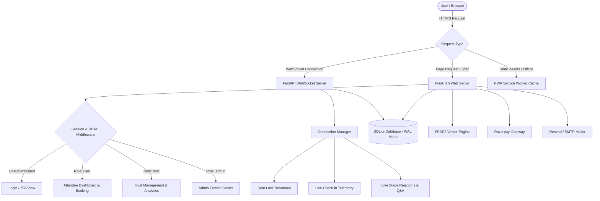
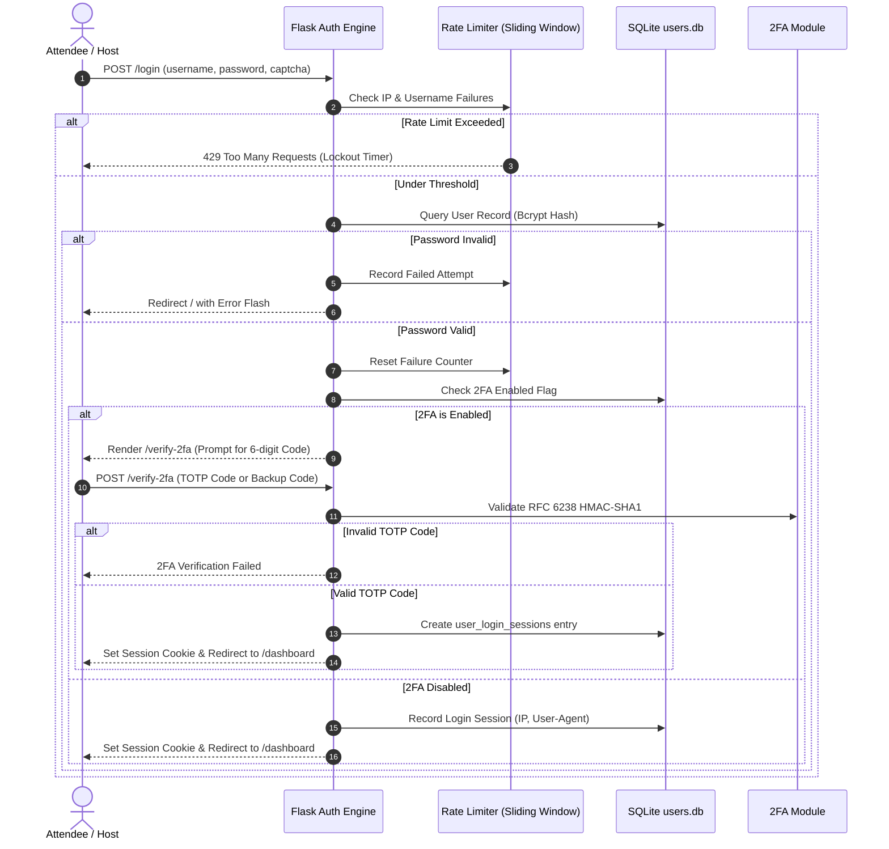
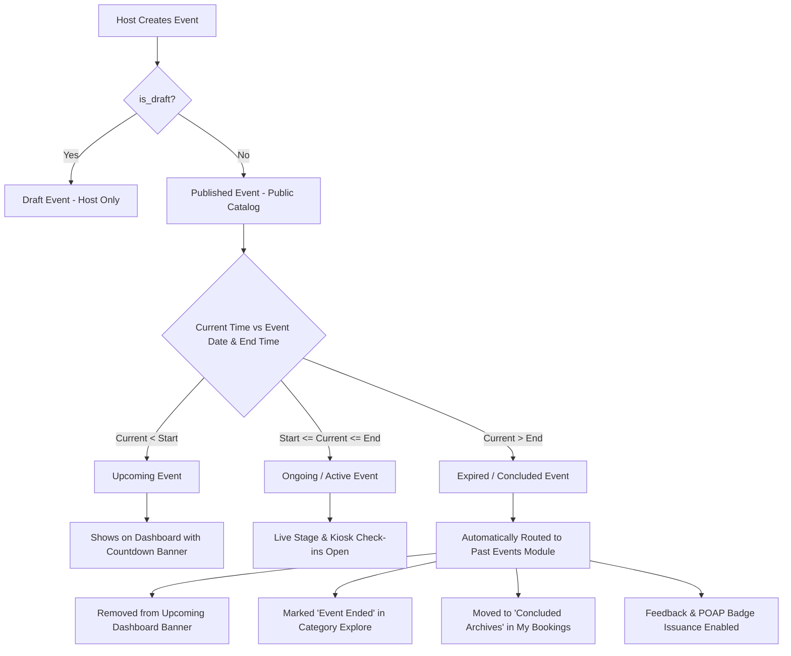
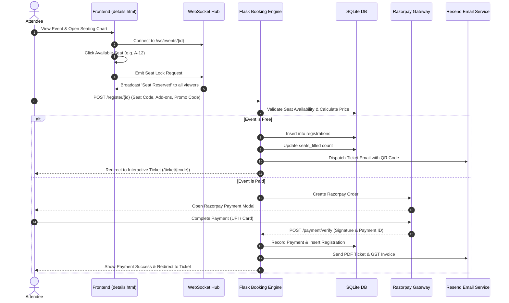
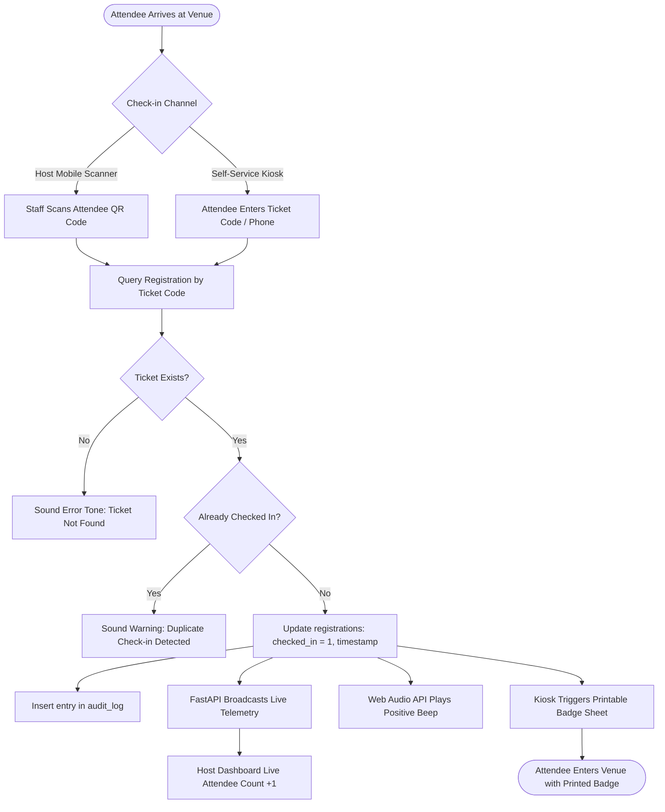
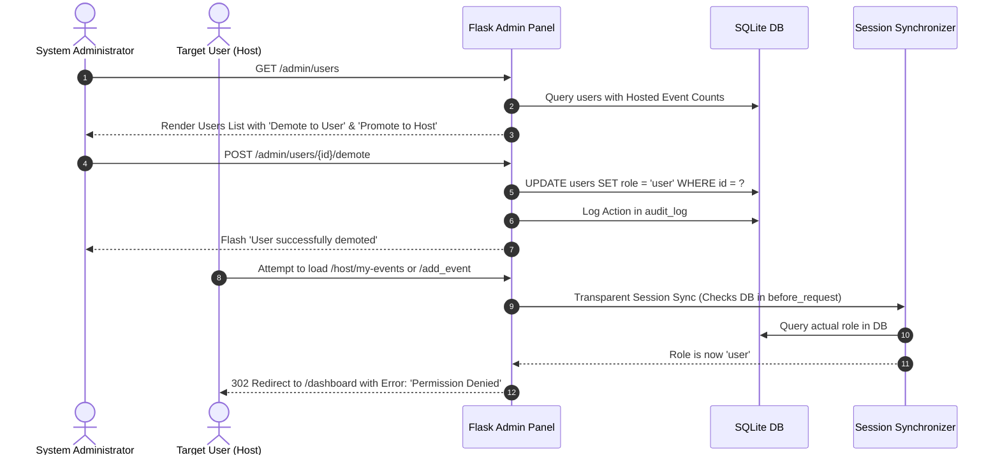
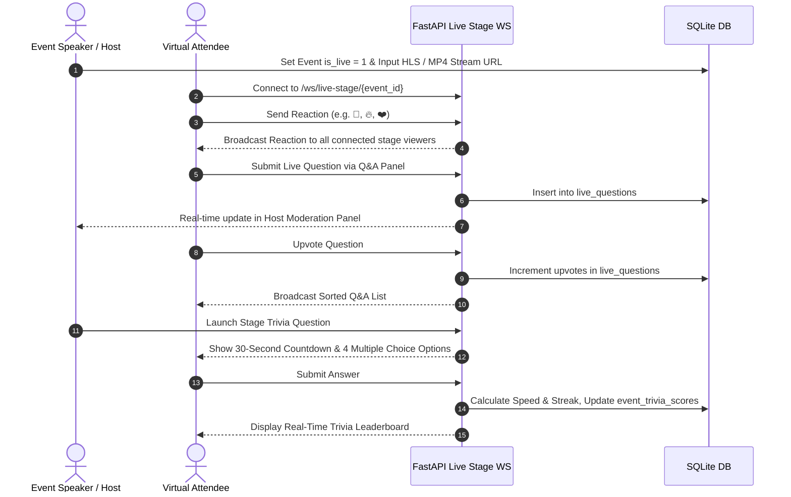
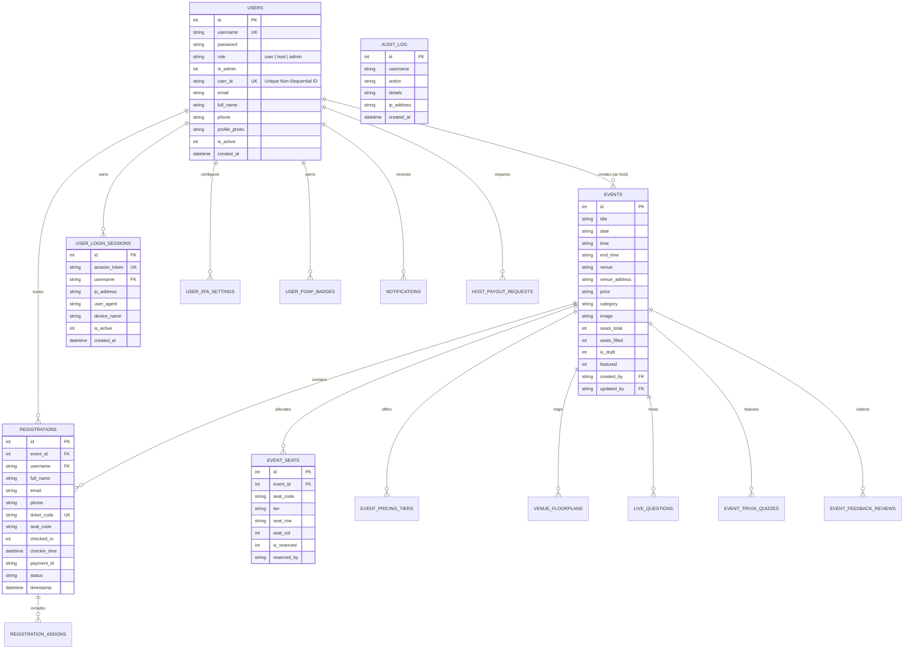

# Complete System Architecture & Technical Documentation
## Enterprise Event Management, Hybrid Live-Stage & Ticketing Platform

> **Project Name:** Events Booking / Event Management System  
> **Platform Version:** 2.5 (Enterprise Edition)  
> **Backend Architecture:** Hybrid Flask 3.0 (SSR & Business Logic) + FastAPI (Asynchronous WebSockets & Real-Time Telemetry)  
> **Primary Storage:** SQLite 3 with Write-Ahead Logging (WAL) & In-Memory Pragma Optimizations  
> **Frontend Engine:** Semantic HTML5, CSS3 Glassmorphism Theme Engine, Vanilla Modern JavaScript (ES6+), Progressive Web App (PWA)  

---

## Table of Contents
1. [Executive Overview & Purpose](#1-executive-overview--purpose)
2. [Languages, Frameworks & Technology Stack](#2-languages-frameworks--technology-stack)
3. [System Architecture & Design Patterns](#3-system-architecture--design-patterns)
4. [Comprehensive System Flowcharts](#4-comprehensive-system-flowcharts)
   - [4.1 End-to-End System Architecture Flow](#41-end-to-end-system-architecture-flow)
   - [4.2 User Authentication, 2FA & Session Security Flow](#42-user-authentication-2fa--session-security-flow)
   - [4.3 Event Lifecycle & Automatic Expiration Flow](#43-event-lifecycle--automatic-expiration-flow)
   - [4.4 Ticket Booking, Dynamic Seating & Checkout Flow](#44-ticket-booking-dynamic-seating--checkout-flow)
   - [4.5 Onsite Check-in, Web Scanner & Kiosk Badge Printing Flow](#45-onsite-check-in-web-scanner--kiosk-badge-printing-flow)
   - [4.6 Role Governance & Instant Demotion Flow](#46-role-governance--instant-demotion-flow)
   - [4.7 Live Stage, Streaming & Audience Interactivity Flow](#47-live-stage-streaming--audience-interactivity-flow)
5. [Core Functional Modules](#5-core-functional-modules)
   - [5.1 User Management, RBAC & Security Infrastructure](#51-user-management-rbac--security-infrastructure)
   - [5.2 Event Management & Dynamic Lifecycle Engine](#52-event-management--dynamic-lifecycle-engine)
   - [5.3 Seating, Floorplan Builder & Dynamic Pricing](#53-seating-floorplan-builder--dynamic-pricing)
   - [5.4 Digital Ticketing, GST Invoicing & Wallets](#54-digital-ticketing-gst-invoicing--wallets)
   - [5.5 Onsite Operations, Scanner & Self-Service Kiosks](#55-onsite-operations-scanner--self-service-kiosks)
   - [5.6 Hybrid Live Stage, Streaming & Interactivity](#56-hybrid-live-stage-streaming--interactivity)
   - [5.7 Host Management Studio, Analytics & Treasury](#57-host-management-studio-analytics--treasury)
   - [5.8 Admin Control Center & Audit Dossiers](#58-admin-control-center--audit-dossiers)
   - [5.9 Community, Networking & Gamification (XP, POAP, Trivia)](#59-community-networking--gamification-xp-poap-trivia)
6. [Database Schema & Entity Relationships](#6-database-schema--entity-relationships)
7. [API & Endpoint Reference](#7-api--endpoint-reference)
8. [Directory & File Structure Map](#8-directory--file-structure-map)
9. [Installation, Testing & Production Deployment](#9-installation-testing--production-deployment)

---

## 1. Executive Overview & Purpose

### 1.1 Project Mission
The **Event Management System** is a full-featured, enterprise-grade hybrid event management, digital ticketing, and live streaming platform. It was engineered to bridge physical venue logistics and virtual digital engagement into a single, cohesive software architecture.

The platform eliminates the fragmentation of using third-party ticketing platforms, separate check-in scanner hardware, disconnected streaming services, and manual invoicing tools by unifying them into one platform:
- **Attendees** can discover physical and virtual events across diverse categories, choose exact seats via visual venue floorplans, pay securely, store tickets in offline PWA / Apple / Google / WhatsApp wallets, attend interactive live stages with real-time Q&A and trivia, and collect POAP NFT-style attendance badges.
- **Hosts (Event Organizers)** gain an isolated management portal where they can create events manually or via AI, configure multi-tiered pricing, design custom venue floorplans, dispatch Call for Proposals (CFP), view real-time attendee check-in telemetry, manage co-hosts, and track revenue and payout requests.
- **Administrators** possess total governance over the ecosystem: promoting verified users to hosts, instantly demoting or restricting privileges, reviewing host dossiers with event attributions, tracking real-time server health metrics, and maintaining an immutable audit log.

### 1.2 Core Personas & Permissions Matrix

| Persona | Core Responsibilities & Privileges | Restricted Actions |
| :--- | :--- | :--- |
| **Normal Attendee (`user`)** | Register/Login, browse events, book tickets, select seats, download PDF tickets/invoices, store tickets offline via PWA, attend live streams, participate in live Q&A/trivia, network with peers, manage personal profile & security. | Cannot create events, cannot access host analytics, cannot access scanner or kiosk, cannot view admin portal. |
| **Event Organizer (`host`)** | All attendee privileges + create and edit own events, design venue layouts, access check-in scanners and kiosk badge printers, view own attendee lists and export CSVs, track revenue and request payouts, manage CFP proposals. | Cannot view or modify events created by other hosts (strict isolation), cannot access admin dashboard, cannot promote/demote users, cannot delete other accounts. |
| **System Administrator (`admin`)** | Full platform root access. View all events, manage all user accounts (promote to host, demote to user, delete non-root accounts), inspect host dossiers with event counts, feature events globally, view immutable system audit logs, configure platform subscriptions. | Cannot delete primary root administrator accounts (`admin`, `venu_r`). |

---

## 2. Languages, Frameworks & Technology Stack

The project utilizes a multi-paradigm, hybrid technology stack chosen for stability, high concurrency, zero-latency real-time updates, and cross-platform offline resilience.

### 2.1 Backend Architecture & Libraries

| Technology / Library | Version | Functional Role & Purpose in Project |
| :--- | :--- | :--- |
| **Python** | 3.10+ / 3.14 | Core programming language powering the entire backend business logic, APIs, background jobs, and data manipulation. |
| **Flask** | 3.0.0 | Primary web application microframework. Handles Server-Side Rendering (SSR), Jinja2 templates, cookie-based session management, form validation, and transactional database queries. |
| **FastAPI** | >=0.100.0 | High-performance asynchronous companion framework running on ASGI. Powers real-time WebSockets, live telemetry feeds, seat-locking broadcasts, and live stage chat/reactions. |
| **Uvicorn** | Standard | Lightning-fast ASGI server implementation used to run FastAPI WebSockets and asynchronous event pipelines concurrently. |
| **SQLite 3** | Built-in | Relational database engine configured with Write-Ahead Logging (WAL) and memory pragmas for high concurrent read/write throughput without locking bottlenecks. |
| **Flask-Bcrypt** | Latest | Secure password hashing using the Blowfish cipher with cryptographic work factor (salt + hash) for all user credentials. |
| **Flask-Cors** | Latest | Cross-Origin Resource Sharing middleware enabling secure cross-origin API and WebSocket access. |
| **FPDF2** | Latest | High-fidelity vector PDF generation engine used to synthesize printable event tickets, official attendee badge sheets, and GST tax invoices. |
| **QRCode & Pillow (PIL)** | Latest | Programmatic generation of 2D QR codes and image manipulation for digital tickets, 2FA authenticator provisioning, and badge graphics. |
| **User-Agents & ua-parser** | Latest | HTTP User-Agent parsing library that converts raw browser headers into human-readable device names (e.g., "Chrome on Windows", "Safari on iPhone") with device icons for session auditing. |
| **python-dotenv** | Latest | Multi-path environment configuration loader supporting local `.env`, Docker containers, and Render secret mounts. |
| **Razorpay SDK** | Latest | Native integration with Razorpay payment gateway for processing debit cards, credit cards, UPI, and net banking transactions. |
| **Resend / Flask-Mail** | Latest | Transactional email dispatch system for automated booking confirmations, calendar invites, and unregistration notices. |
| **OpenAI / Gemini API** | Latest | Large Language Model integrations powering the "AI Magic Event Creator" and marketing studio for automated agendas, descriptions, and tags. |
| **a2wsgi / asgiref** | Latest | WSGI-to-ASGI adapters enabling seamless interoperability between Flask and FastAPI in hybrid server deployments. |

### 2.2 Frontend Architecture & Client Technologies

| Technology | Functional Role & Implementation Details |
| :--- | :--- |
| **HTML5** | Semantic, accessible markup structured across 52 specialized Jinja2 templates covering attendee, host, and admin views. |
| **CSS3 & Design System** | Bespoke Glassmorphism visual design system with CSS custom properties (`--bg-primary`, `--accent`, `--card-bg`), fully responsive flexbox & CSS grid layouts, animated gradient borders, and dark/light mode switching. |
| **Vanilla JavaScript (ES6+)** | Modular client-side scripts (`animations.js`, `chatbot.js`, `confetti.js`, `notifications.js`, `realtime.js`, `pwa.js`) handling DOM manipulation without bloated heavy frontend frameworks. |
| **WebSockets (Native WS API)** | Native browser WebSocket client connecting to the FastAPI server for real-time seat locks, live attendee counters, live Q&A upvotes, and trivia. |
| **Progressive Web App (PWA)** | Service Worker (`sw.js`) and Web App Manifest (`manifest.json`) providing offline ticket wallet capabilities, caching static assets, and enabling "Add to Home Screen". |
| **Html5-QRCode Scanner** | In-browser camera scanning engine utilizing WebRTC video feeds to detect and decode attendee QR codes directly on smartphones and tablets. |
| **Web Audio API** | Synthesizes instant sound feedback (positive chime on successful check-in, alert buzz on duplicate or invalid tickets) directly in the browser without external audio assets. |

### 2.3 DevOps, Deployment & Infrastructure

| Component | Configuration & Purpose |
| :--- | :--- |
| **Docker** | Multi-stage `Dockerfile` with optimized Python runtime, pre-installed dependencies, and non-root execution for containerized orchestration. |
| **Render Blueprint (`render.yaml`)** | Infrastructure-as-Code deployment manifest configuring persistent disk storage (`/data`), environment variables, and auto-deploy pipelines. |
| **Procfile** | Gunicorn / Uvicorn entrypoints for production process management. |
| **run_server.bat** | Windows batch launcher for one-click local development startup. |

---

## 3. System Architecture & Design Patterns

The Event Management System utilizes a **Hybrid Dual-Engine Architecture**:

```
                              ┌────────────────────────────────────────┐
                              │       Client Browser / PWA App         │
                              └────────────────────┬───────────────────┘
                                                   │
                         ┌─────────────────────────┴─────────────────────────┐
                         │                                                   │
              HTTP / REST (Port 5000)                              WebSockets (FastAPI / ASGI)
                         │                                                   │
                         ▼                                                   ▼
            ┌─────────────────────────┐                         ┌─────────────────────────┐
            │       Flask 3.0         │                         │         FastAPI         │
            │   (SSR & Logic Engine)  │                         │   (Real-Time Engine)    │
            ├─────────────────────────┤                         ├─────────────────────────┤
            │ • Jinja2 Template Views │                         │ • Live Seat Locking     │
            │ • Session Security/RBAC │                         │ • Live Stage Broadcast  │
            │ • Checkout & Payments   │                         │ • Check-in Telemetry    │
            │ • PDF Ticket Generation │                         │ • Q&A Upvote Sync       │
            │ • Admin & Host Portals  │                         │ • Real-time Trivia      │
            └────────────┬────────────┘                         └────────────┬────────────┘
                         │                                                   │
                         └─────────────────────────┬─────────────────────────┘
                                                   │
                                                   ▼
                                      ┌─────────────────────────┐
                                      │  SQLite 3 (users.db)    │
                                      │ • WAL Mode Enabled      │
                                      │ • Pooled Thread-Local   │
                                      │ • Memory Cache Pragmas  │
                                      │ • 67 Structured Tables  │
                                      └─────────────────────────┘
```

### Key Architectural Patterns:
1. **Separation of Concerns:** Heavy synchronous rendering, PDF compilation, and transactional SQL operations are cleanly separated into Flask, while high-frequency WebSocket streams operate in FastAPI without blocking request threads.
2. **SQLite WAL (Write-Ahead Logging):** SQLite is optimized with `PRAGMA journal_mode=WAL`, `PRAGMA busy_timeout=60000`, and `PRAGMA synchronous=NORMAL`. This permits multiple concurrent read operations even while write transactions are actively committing.
3. **Optimistic Real-Time Concurrency:** When attendees select seats on the venue floorplan, WebSockets broadcast temporary seat reservations to all connected viewers to prevent race conditions before payment.
4. **Offline First (PWA):** The attendee digital pass is saved locally in IndexedDB / CacheStorage via the Service Worker. If network connectivity drops at a convention center or stadium, the ticket barcode and QR code remain fully readable.

---

## 4. Comprehensive System Flowcharts

### 4.1 End-to-End System Architecture Flow



---

### 4.2 User Authentication, 2FA & Session Security Flow



---

### 4.3 Event Lifecycle & Automatic Expiration Flow



---

### 4.4 Ticket Booking, Dynamic Seating & Checkout Flow



---

### 4.5 Onsite Check-in, Web Scanner & Kiosk Badge Printing Flow



---

### 4.6 Role Governance & Instant Demotion Flow



---

### 4.7 Live Stage, Streaming & Audience Interactivity Flow



---

## 5. Core Functional Modules

### 5.1 User Management, RBAC & Security Infrastructure
- **Bcrypt Password Security:** All passwords are salted and hashed using `Flask-Bcrypt`. Plaintext passwords are never persisted.
- **Two-Factor Authentication (2FA / TOTP):** Full RFC 6238 implementation in `platform_services.py`. Users can scan a provisioning QR code into Google Authenticator or Microsoft Authenticator. 8 cryptographically secure single-use backup codes are generated during setup.
- **Brute-Force Rate Limiting:** Sliding-window login failure tracking by client IP and account username. Automatically locks out brute-force attacks for 60 seconds after 6 consecutive failures.
- **Custom Mathematical SVG CAPTCHA:** Handcrafted SVG generator that creates unique distorted visual CAPTCHAs without relying on third-party tracking services or external CDNs.
- **User-Agent Session Intelligence:** Automatically parses browser User-Agent strings via `ua-parser` into clean device profiles (e.g., "Edge on Windows", "Safari on iPhone") with timestamps and IP addresses. Users can review active sessions and revoke foreign sessions with one click.
- **Account Deletion & Demotion Protection:** Root administrative accounts (`admin`, `venu_r`) are strictly protected in code against deletion or accidental modification.

---

### 5.2 Event Management & Dynamic Lifecycle Engine
- **Event Categorization:** Comprehensive catalog supporting diverse domains: *Technology, Business, Medical, Entertainment, Sports, Agriculture, and Community*.
- **Lifecycle Engine:** Automatically tracks the operational state of every event:
  - `Upcoming`: Event date is in the future. Prominently featured on the dashboard with a live countdown timer banner.
  - `Ongoing`: Event is happening right now. Scanner, kiosk, and live stages are open.
  - `Concluded / Expired`: Event end time has passed. System dynamically routes concluded events into the Past Archives module, removing them from registration queues and unlocking feedback reviews.
- **AI Magic Event Creator:** Integrated OpenAI / Gemini prompt engineering allowing organizers to type a single topic (e.g., "Autonomous Robotics Hackathon") and generate complete agendas, pricing models, descriptions, outcomes, and tags in seconds.
- **Draft & Featured Toggles:** Hosts can build events in draft mode before publishing. System administrators can toggle global "Featured" status to spotlight high-priority events.

---

### 5.3 Seating, Floorplan Builder & Dynamic Pricing
- **Interactive Venue Floorplan:** Interactive visual seating charts supporting up to 18,000+ seat coordinates with zone classifications (Front Row VIP, Orchestra, Balcony, General).
- **Seat Conflict Detector:** Uses WebSocket locks to prevent double-booking. When an attendee clicks a seat, it locks in real-time across all connected clients.
- **Multi-Tiered Pricing Engine:** Supports free events, flat-rate events, and multi-tiered allocations (e.g., Early Bird ₹499, Regular ₹999, VIP ₹2,499).
- **Discount & Promo Code Engine:** Organizers can configure percentage or fixed-value promo codes with maximum usage limits and expiry timestamps.

---

### 5.4 Digital Ticketing, GST Invoicing & Wallets
- **High-Density Vector PDF Tickets:** Generates downloadable PDF passes via `FPDF2` containing event metadata, seat numbers, attendee names, instructions, and an embedded 2D QR code.
- **Statutory GST Tax Invoicing:** Calculates CGST, SGST, and IGST breakdowns dynamically based on ticket pricing, outputting formal, tax-compliant GST invoices.
- **Multi-Platform Digital Wallets:**
  - **PWA Offline Wallet:** Attendees can access their tickets inside the Progressive Web App even when airplane mode is on or mobile network is congested.
  - **Mobile Web Pass:** Optimized mobile wallet layout with high-contrast barcode display.
  - **WhatsApp Instant Pass:** One-click integration to share ticket codes and directions directly to WhatsApp.
  - **iCalendar (.ics) Sync:** Standardized `.ics` calendar invite downloads that automatically add event reminders to Apple Calendar, Google Calendar, and Outlook.
- **Ticket Transfers & Refunds:** Attendees can securely transfer tickets to a colleague's email address or request cancellations governed by configurable refund policies (flexible, moderate, strict).

---

### 5.5 Onsite Operations, Scanner & Self-Service Kiosks
- **Web QR Scanner (`/scan_ticket`):** Real-time web camera scanner utilizing `Html5-QRCode`. Supports rear-camera autofocus, flashlight toggle, and instant audio chimes.
- **Self-Service Check-in Kiosk (`/kiosk/<id>`):** High-throughput kiosk interface where attendees enter their ticket code or phone number to check in.
- **Batch Badge Printing Sheet:** Formats print-ready badge sheets (`badge_sheet.html`) designed for standard Avery lanyard badge cards.
- **Check-in History & Resilience:** Maintains an audit trail of every check-in event with timestamp, staff username, and entry gate location.

---

### 5.6 Hybrid Live Stage, Streaming & Interactivity
- **Hotstar-Style Live Video Stage:** Responsive HTML5 video player supporting HLS streaming, MP4 feeds, and YouTube/Vimeo embeds with low latency.
- **Live Reactions:** Real-time floating emojis (claps, hearts, fire, confetti) broadcasted across all active virtual viewers.
- **Audience Q&A with Upvoting:** Virtual attendees submit questions that other attendees can upvote in real-time, sorting the most urgent questions to the top of the speaker's queue.
- **Multiplayer Stage Trivia:** Interactive quiz controller where organizers can broadcast timed trivia questions, tracking correct answers, speed, and live leaderboards.
- **Multilingual Captions:** Integrated live caption stream for accessibility and cross-regional language support.

---

### 5.7 Host Management Studio, Analytics & Treasury
- **Strict Host Event Isolation:** Organizers have full visibility and control over their own events (`/host/my-events`), but are strictly blocked from editing, viewing attendee data, or deleting events belonging to other organizers.
- **Host Analytics Dashboard:** Visual performance graphs displaying registration velocity, ticket sales breakdown by tier, attendance check-in percentages, and net revenue.
- **Host Financial Treasury & Payouts:** Calculates gross ticket sales, platform commission deductions, and GST withholdings. Hosts can submit automated payout withdrawal requests to their bank account or UPI ID.
- **Call for Proposals (CFP) Engine:** Built-in submission portal where prospective speakers submit talk proposals, session abstracts, and bios for host review and approval.
- **Co-Host Team Management:** Allows primary hosts to invite team members with granular roles (e.g., Gate Scanner, Stage Moderator, Analytics Viewer).

---

### 5.8 Admin Control Center & Audit Dossiers
- **System Overview Dashboard:** Real-time metrics tracking total registered users, total events, cumulative ticket revenue, active WebSocket connections, and database performance.
- **User Governance & Role Switching:** Admin panel allows promoting standard attendees to verified hosts with one click, or instantly demoting hosts back to standard users.
- **Host Dossiers with Event Attribution:** Admins can click on any host user profile in the admin panel to open an in-depth dossier displaying the host's biographical information, verification status, and an itemized gallery of every event created by that host with individual attendee counts.
- **Immutable System Audit Trail (`/admin/audit`):** Logs every sensitive administrative and security operation (user deletions, role changes, event purges, login sessions) with IP address and timestamp.

---

### 5.9 Community, Networking & Gamification (XP, POAP, Trivia)
- **Peer Networking & Profiles:** Attendees can publish professional bios, skill tags, and social handles, sending 1-on-1 networking connection requests to fellow attendees.
- **Proof of Attendance Protocol (POAP) Badges:** Attendees who complete check-in receive digital collectible POAP badges displayed on their profile passport.
- **Gamification XP Engine & Rewards Store:** Users earn Experience Points (XP) for registering early, checking in on time, asking top-voted questions, and winning stage trivia. XP can be redeemed in the Rewards Store for ticket discount vouchers.
- **Verified Attendee Reviews & NPS:** Only attendees with verified check-ins are permitted to submit 5-star reviews, detailed feedback, and Net Promoter Scores (NPS).

---

## 6. Database Schema & Entity Relationships

The platform database (`backend/users.db`) contains **67 tables**. Below is the core Entity-Relationship Diagram detailing the primary business models:



### Complete Database Tables Inventory (Categorized)

1. **Authentication & User Management:** `users`, `user_2fa_settings`, `user_login_sessions`, `audit_log`, `notifications`.
2. **Event Catalog & Seating:** `events`, `event_seats`, `event_pricing_tiers`, `venue_floorplans`, `event_series`, `promo_codes`, `event_sponsors`.
3. **Ticketing, Registrations & Checkout:** `registrations`, `group_bookings`, `registration_addons`, `registration_custom_answers`, `razorpay_orders`, `user_wallet`, `wallet_transactions`.
4. **Onsite Logistics & Scanner Operations:** `attendee_badges`, `checkin_history`, `sponsor_leads`.
5. **Hybrid Live Stage & Streaming:** `event_livestreams`, `live_stream_passes`, `live_questions`, `live_question_upvotes`, `live_polls`, `live_poll_votes`, `live_reactions`, `live_hand_raises`, `event_broadcast_history`.
6. **Audience Engagement & Gamification:** `event_trivia_quizzes`, `event_trivia_scores`, `user_poap_badges`, `xp_rewards_catalog`, `xp_redemptions`, `event_feedback_reviews`, `reviews`.
7. **Host Operations & Treasury:** `host_payout_requests`, `host_team_members`, `host_webhooks`, `webhook_deliveries`, `event_speaker_proposals`.
8. **Subscriptions & Membership Plans:** `subscriptions`, `subscription_payments`, `subscription_refunds`, `subscription_usage`, `subscription_coupons`.
9. **Peer Networking & Team Hackathons:** `peer_networking_profiles`, `peer_connection_requests`, `user_connections`, `teams`, `team_match_posts`, `team_submissions`, `team_judge_scores`, `user_saved_agenda`.

---

## 7. API & Endpoint Reference

The system exposes **190 HTTP endpoints** across Flask and **FastAPI WebSockets**. Below is an index of the most critical endpoints:

### 7.1 Core Authentication & Session Routes
- `GET, POST /`: Login portal with CAPTCHA validation.
- `GET, POST /registration`: New user account registration.
- `GET /logout`: Terminate session and invalidate session tokens.
- `GET, POST /verify-2fa`: Second-factor TOTP and emergency backup code verification.
- `GET /api/check-username`: Asynchronous username validation and availability check.
- `GET /api/captcha/refresh`: Refreshes distorted SVG login CAPTCHA.
- `GET /settings`: Account security portal, password update, and session viewer.
- `POST /settings/sessions/revoke-others`: Terminate all active sessions except the current device.

### 7.2 Attendee Event & Ticketing Routes
- `GET /dashboard`: Attendee home portal with search, live countdown banner, and category pills.
- `GET /category/<name>`: Filter catalog by event category.
- `GET /event/<id>`: Full event details, speaker profiles, and agenda.
- `GET, POST /register/<id>`: Registration checkout, seat reservation, and add-on selection.
- `GET /ticket/<ticket_code>`: Interactive digital pass with live QR code.
- `GET /download_ticket/<id>`: Downloads high-resolution vector PDF ticket.
- `GET /download_invoice/<id>`: Downloads tax-compliant GST PDF invoice.
- `POST /unregister/<id>`: Cancel registration and trigger refund calculation.
- `POST /ticket/<ticket_code>/transfer`: Transfer ticket ownership to another user.
- `GET /event/<id>/calendar.ics`: Download iCalendar invite file.

### 7.3 Onsite Scanner & Kiosk Routes
- `GET /scan_ticket`: In-browser QR camera scanner for gate staff.
- `GET /kiosk/<event_id>`: Attendee self-service check-in kiosk.
- `GET /kiosk/<event_id>/badge-sheet/<ticket_no>`: Printable badge sheet generation.
- `GET /checkin_history`: Comprehensive event attendance history log.

### 7.4 Host Management Routes
- `GET, POST /add_event`: Event creation studio with optional AI generation.
- `GET /host/my-events`: Host portal showing isolated list of events created by the logged-in host.
- `GET /host/analytics`: Aggregate attendee conversion, revenue, and check-in metrics.
- `GET /host/treasury`: Financial management, platform commission splits, and payout withdrawals.
- `GET /host/event/<id>/export-attendees`: Download attendee roster as CSV.
- `POST /delete_event/<id>`: Remove an event (restricted strictly to event creator or admin).

### 7.5 Admin Governance Routes
- `GET /admin`: System administration dashboard and server telemetry.
- `GET /admin/users`: User management table with hosted event counts.
- `GET /admin/user/<id>`: Admin host dossier displaying all events attributed to that host.
- `POST /admin/users/<id>/promote`: Elevate user account to host status.
- `POST /admin/users/<id>/demote`: Demote host account to normal user status.
- `POST /admin/users/<id>/delete`: Delete non-root user accounts.
- `GET /admin/audit`: Immutable administrative audit logs.

### 7.6 FastAPI Real-Time WebSocket Channels
- `ws://HOST/ws/events/{event_id}`: Real-time floorplan seat reservation sync.
- `ws://HOST/ws/telemetry`: Instant check-in gate telemetry broadcasts.
- `ws://HOST/ws/live-stage/{event_id}`: Low-latency live stage emojis, Q&A upvotes, and trivia responses.

---

## 8. Directory & File Structure Map

```
c:\My Projects\Event managment system\
│
├── backend\                             # Core Application Backend
│   ├── app.py                           # Primary Flask 3.0 server (Routes, DB migrations, SSR)
│   ├── fastapi_app.py                   # FastAPI ASGI companion (WebSockets & real-time telemetry)
│   ├── platform_services.py             # Security services (2FA/TOTP, CAPTCHA, Rate limiter, Refunds)
│   ├── users.db                         # Production SQLite 3 database (WAL mode)
│   ├── database.db                      # Legacy SQLite fallback database
│   ├── test_new_features.py             # Automated pytest suite for security, roles & lifecycle
│   ├── test_system.py                   # Integration test suite for core workflows
│   ├── test_platform_pillars.py         # Test suite for 2FA, CSRF, transfers & wallets
│   ├── Dockerfile                       # Backend containerization configuration
│   ├── Procfile                         # Production web process definition
│   └── render.yaml                      # Render cloud hosting blueprint
│
├── frontend\                            # Client Presentation Layer
│   ├── templates\                       # 52 Jinja2 HTML Templates
│   │   ├── admin\                       # Administrative templates (audit, dashboard, users, dossiers)
│   │   ├── dashboard.html               # Attendee main catalog & countdown banner
│   │   ├── details.html                 # Event detail view & seat picker modal
│   │   ├── ticket.html                  # Interactive ticket pass view
│   │   ├── kiosk.html                   # Onsite check-in kiosk view
│   │   ├── scanner.html                 # Mobile camera QR scanner
│   │   ├── my_hosted_events.html        # Isolated host event manager
│   │   ├── host_analytics.html          # Host business metrics & revenue graphs
│   │   ├── live_stage.html              # Interactive live streaming stage
│   │   └── settings.html                # Security settings, 2FA & active sessions
│   │
│   └── static\                          # Static Assets & Client Scripts
│       ├── style.css                    # Master Glassmorphism CSS design system
│       ├── pwa.js                       # Service worker registration & offline cache logic
│       ├── realtime.js                  # WebSocket client handlers
│       ├── manifest.json                # PWA Progressive Web App manifest
│       ├── event_images\                # Event promotional artwork assets
│       └── uploads\                     # User profile photos & media uploads
│
├── docs\                                # Project Documentation
│   └── PROJECT_DOCUMENTATION.md         # Comprehensive architectural & developer documentation
│
├── requirements.txt                     # Python package dependencies
├── run_server.bat                       # Local development startup script
└── README_DEPLOYMENT.md                 # Cloud deployment instructions
```

---

## 9. Installation, Testing & Production Deployment

### 9.1 Local Environment Prerequisites
- **Operating System:** Windows, macOS, or Linux.
- **Python Version:** Python 3.10, 3.11, 3.12, 3.13, or 3.14.
- **Package Manager:** `pip`.

### 9.2 Step-by-Step Local Setup

1. **Clone the Repository & Navigate to Project Directory:**
   ```bash
   git clone https://github.com/venur4080-jpg/Event-Management-System.git
   cd "Event managment system"
   ```

2. **Create and Activate a Virtual Environment:**
   ```bash
   # On Windows (PowerShell):
   python -m venv .venv
   .venv\Scripts\Activate.ps1

   # On macOS / Linux:
   python3 -m venv .venv
   source .venv/bin/activate
   ```

3. **Install Dependencies:**
   ```bash
   pip install -r requirements.txt
   ```

4. **Initialize Environment Variables:**
   Create a `.env` file in the root or `backend/` directory:
   ```env
   SECRET_KEY=your-super-secret-random-key-here
   FLASK_ENV=development
   PORT=5000
   SMTP_EMAIL=your-email@gmail.com
   SMTP_PASSWORD=your-app-specific-password
   RAZORPAY_KEY_ID=rzp_test_xxxx
   RAZORPAY_KEY_SECRET=xxxx
   OPENAI_API_KEY=sk-xxxx
   ```

5. **Start the Application Server:**
   ```bash
   # Option A: Run Flask Application directly:
   python backend/app.py

   # Option B: Run via Windows batch script:
   .\run_server.bat
   ```
   Open your browser and navigate to: `http://127.0.0.1:5000`

---

### 9.3 Running Automated Test Suites

The project includes 53 comprehensive unit and integration tests verifying authentication, role isolation, ticket transfers, seat allocation, and lifecycle routing:

```bash
# Run all test suites:
pytest backend/test_new_features.py backend/test_system.py backend/test_platform_pillars.py -v

# Run specific security & role tests:
pytest backend/test_new_features.py -v
```

---

### 9.4 Cloud Deployment (Docker & Render)

#### Deploying with Docker:
```bash
# Build the Docker image:
docker build -t event-management-system:latest -f backend/Dockerfile .

# Run the container:
docker run -d -p 5000:5000 --name event_app -v event_data:/data event-management-system:latest
```

#### Deploying on Render:
1. Connect your GitHub repository to [Render.com](https://render.com).
2. Use the provided [`render.yaml`](file:///c:/My%20Projects/Event%20managment%20system/render.yaml) blueprint.
3. Configure persistent disk mounting at `/data` to ensure `users.db` is permanently preserved across deployments.
4. Set build command: `pip install -r requirements.txt`.
5. Set start command: `gunicorn --worker-class gevent --workers 2 --bind 0.0.0.0:5000 backend.app:app`.
